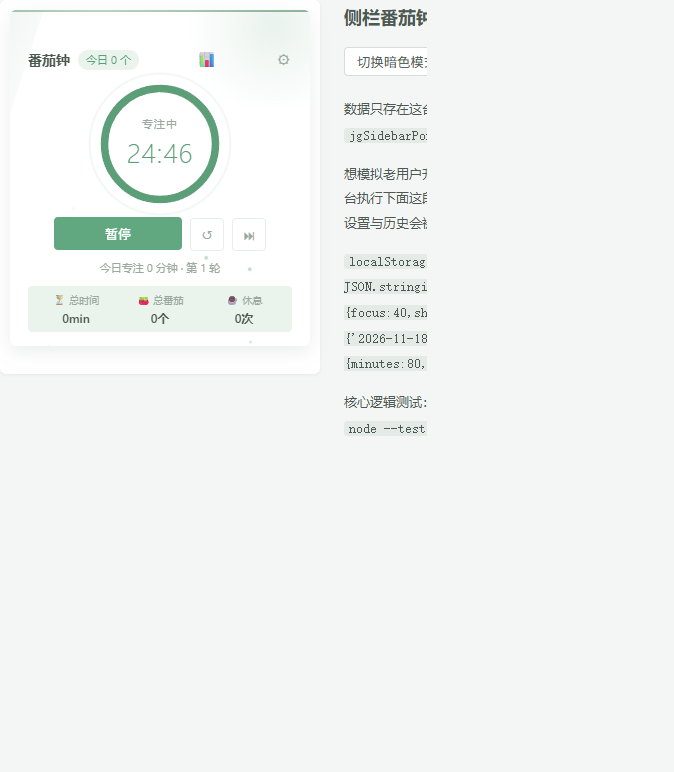

# Typecho Handsome 番茄钟控件

给 Typecho 的 Handsome 主题加一个番茄钟：**零依赖、零网络请求、纯前端**。计时用绝对时间戳，切后台 / 合盖 / 睡一觉回来都不漂移；数据只存在这台设备的 `localStorage`。样式和脚本通过主题自带的 `customCss` / `customJs` 注入，**不改主题任何模板**，主题升级不会丢，删掉标记块即卸载。

同一套代码提供两种形态：



| | 侧栏版（推荐，v2） | 悬浮版（v1，旧） |
| --- | --- | --- |
| 位置 | `#sidebar` 内、天气卡片下方 | 右下角悬浮球 + 面板，挂 `body` 末尾 |
| 依赖 | 需要右侧栏（全宽模板不显示，跟随主题） | 任何模板都能用 |
| 文件 | `sidebar-pomodoro.css` / `sidebar-pomodoro.js` | `pomodoro.css` / `pomodoro.js` |
| 标记块 | `JG-SIDEBAR-POMO-START/END` | `JG-POMODORO-START/END` |
| 存储键 | `jgSidebarPomo.v2` | `jgPomodoro.v1` |
| 独有 | 周视图柱状图、累计指标、每 N 番茄长休、标题栏倒计时、自动开始休息、氛围动效 | 更轻，只需一个小球 |

侧栏版会自动迁移旧悬浮版的 `jgPomodoro.v1` 数据（历史 + 时长设置），迁移后旧数据仍保留，可回退。

---

## 文件

| 文件 | 作用 | 放哪 |
| --- | --- | --- |
| `sidebar-pomodoro.js` | 侧栏版：纯函数核心（日期 / 时长 / 迁移 / 状态机）+ UI 层 | 注入 `customJs`，或外部文件方式 |
| `sidebar-pomodoro.css` | 侧栏版样式与动效关键帧 | 注入 `customCss`，或外部文件方式 |
| `pomodoro.js` / `pomodoro.css` | 悬浮版 v1 | 同上 |
| `install-sidebar.php` | 幂等安装侧栏版：把 css / js 用标记块写进主题设置并回读校验 | 任意目录，执行一次 |
| `install-floating.php` | 同上，装悬浮版 | 同上 |
| `demo.html` | 本地演示页，双击即可打开 | 本地 |
| `tests/core.test.js` | 侧栏版纯函数核心测试（Node 内置 test，23 例） | 本地 |
| `tests/floating.test.js` | 悬浮版核心测试（14 例） | 本地 |
| `screenshot.png` | 预览图 | — |

---

## 安装

前置：Typecho + Handsome 主题（主题目录名 `handsome`）、PHP 7.4+。**先备份数据库**，脚本会改 `typecho_options` 里的一行。

### 方式 A：注入全文（推荐，最省事）

```bash
php install-sidebar.php /你的/typecho/站点根目录
```

脚本会读站点 `config.inc.php` 拿数据库连接信息（不硬编码任何凭据）、备份原主题配置、用标记块幂等替换 `customCss` / `customJs`，最后回读校验字段数没变、标记各只出现一次。重复执行安全。

不想跑脚本也行：把 `sidebar-pomodoro.css` 全文粘进主题设置「自定义 CSS」、`sidebar-pomodoro.js` 全文粘进「自定义 JavaScript」。

### 方式 B：外部文件 + 加载器（极客港线上用法）

把 `sidebar-pomodoro.css` / `sidebar-pomodoro.js` 放到站点 `/pomodoro/` 目录，主题设置的「自定义 JavaScript」里只加一小段加载器（标记块内）：

```js
/* JG-SIDEBAR-POMO-START */
(function () {
    var V = '2.1.3';
    if (!document.getElementById('jgsp-css')) {
        var l = document.createElement('link');
        l.id = 'jgsp-css'; l.rel = 'stylesheet';
        l.href = '/pomodoro/sidebar-pomodoro.css?v=' + V;
        document.head.appendChild(l);
    }
    if (window.__jgSidebarPomoMounted || document.getElementById('jgsp-js')) return;
    window.__jgSidebarPomoMounted = true;
    var s = document.createElement('script');
    s.id = 'jgsp-js';
    s.src = '/pomodoro/sidebar-pomodoro.js?v=' + V;
    document.body.appendChild(s);
})();
/* JG-SIDEBAR-POMO-END */
```

好处：主题设置只多一小段，更新文件即生效，`?v=` 改版本号就能破缓存。

### 卸载

从 `customCss` / `customJs` 删掉标记块之间的内容；方式 B 还要删掉 `/pomodoro/` 下对应文件。备份在 `站点根目录/../pomodoro-backup/`。

---

## 功能

- 专注 / 短休 / 长休三种模式，时长与「每 N 个番茄长休」可调（1–180 / 1–60 / 1–120 分，2–12 个）。
- 绝对时间戳计时：`endAt = Date.now() + remaining*1000`，刷新页面、切后台回来都按真实时间结算。
- 数据存 `localStorage`，键 `jgSidebarPomo.v2`；历史只留近 30 天，不会无限膨胀。
- 周视图柱状图（近 7 天专注分钟）、累计指标（总时间 / 总番茄 / 休息次数）。
- 标题栏倒计时、完成提示音（Web Audio）、自动开始下一阶段。
- 完成时桌面通知：系统级提醒（需浏览器授权，未授权时设置面板会给出「允许浏览器通知」按钮），点击通知回到页面；浏览器不支持则整行隐藏。
- PJAX 换页 / 主题动态挂载：监听 `pjax:end` / `pjax:complete`，外加 `MutationObserver` 兜底重挂。

---

## 动效

侧栏版与天气卡片同款「白底绿系 + 卡片内部动图」：

- 顶部渐变条缓慢流动；极淡光晕呼吸；周期性扫光。
- 专注粒子：空闲时缓慢上浮（暗示控件是活的），运行中更快更亮。
- 进度环外侧呼吸光；完成时一圈粒子向外散开；进度环「完成」弹一下。
- 所有动画只用 `transform` / `opacity`，控件本体不做位移，不干扰阅读。
- `prefers-reduced-motion: reduce` 时关掉全部动画与粒子；暗色模式下粒子层降低不透明度。

---

## 测试

```bash
npm test          # 即 node --test（自动发现 tests/）
```

`sidebar-pomodoro.js` 把状态与日期逻辑抽成了不碰 DOM 的纯函数核心 `Core`（浏览器挂 `window.JGPomodoroCoreV2`，Node 下 `require` 导出），`pomodoro.js` 同样导出 `Core`。测试覆盖：时长夹取、日期键与近 7 天（含跨月）、时钟格式化、历史累加、旧数据迁移、30 天裁剪、剩余时间 / 进度、长休节奏、完成一轮的状态迁移（含不改入参），共 37 例。

---

## 实现里几个踩过的点（v2.2.0 / v2.1.3 修复）

### v2.2.0 桌面通知

- **权限是异步的，但设置面板是同步保存的**：保存时若还没授权，先弹系统授权框，拿到 `granted` / `denied` 再把 `notify` 落库。否则用户勾了、保存了、实际没授权，会误以为通知在响。
- **被拒 / 不支持时存 `false`**：`Notification.permission === 'denied'` 或浏览器没有 `Notification` 时，保存动作直接把 `notify` 置为 `false`；浏览器不支持时设置面板里这一行整个隐藏。
- **通知不能当唯一提醒**：`sound` 与 `notify` 相互独立，且 `notify` 只在 `permission === 'granted'` 时才发；锁屏 / 静音设备上仍靠提示音与标题栏倒计时。

### v2.1.3

- **近 7 天在夏令时地区算错**：原来用「今天 0 点减 N×86400000」，在实行夏令时的地区会落到 23:00 / 01:00，导致周视图重复或跳号。改成用本地日历日期回退 `new Date(y, m, d - i)`。
- **旧数据永远迁不进来**：判定「有没有历史」时用 `fresh().history`（空对象）当标准，空对象也是对象，迁移分支从不执行。改成「新键无有效历史 **且** 旧键存在」才迁移，迁移后直接给一整轮新时长。
- **改时长后剩余时间比新时长还长**：例如 25 分改 10 分，旧的 1500 秒没被夹回。归一化时对未运行状态做 `remaining > duration` 夹取。
- **提示音句柄堆积**：每次完成都 `new AudioContext()` 再 `close()`，反复完成后句柄越堆越多。改为复用单例，`suspended` 时 `resume()`。
- **总时长单位不统一**：周视图用 `h…m`，指标行用 `h…min`。统一成 `h…min`。
- **减少动态效果漏项**：`prefers-reduced-motion` 列表漏了空闲态漂移粒子，补上。

悬浮版 v1 同步修了四处：

- **跳过被记成完成**：`skip()` 原来调用 `complete()`，跳过的番茄也计入统计。改成只切阶段、不计数。
- **提示音句柄堆积**：同 v2，改为复用单个 `AudioContext`。
- **autoFocus 没有开关**：核心早就支持「休息后自动开始专注」，设置面板却只暴露了「自动开始休息」。补上复选框。
- **死代码**：删掉未使用的 `esc()` 与 `CSS_HREF`。

---

## 已验证环境

Typecho 1.3.0 + Handsome 10.1.0 + PHP 8.5，桌面与移动宽度、浅色与暗色模式、首页 / 文章页 / 独立页面、PJAX 换页。全宽模板（时光机）不显示侧栏版，这是跟随主题的正确行为，想要全模板可用请装悬浮版。其他 Typecho / Handsome 版本未逐个验证；主题目录名不是 `handsome` 时改安装脚本顶部的 `OPTION_NAME`。

---

## 许可

MIT，见 [LICENSE](LICENSE)。
